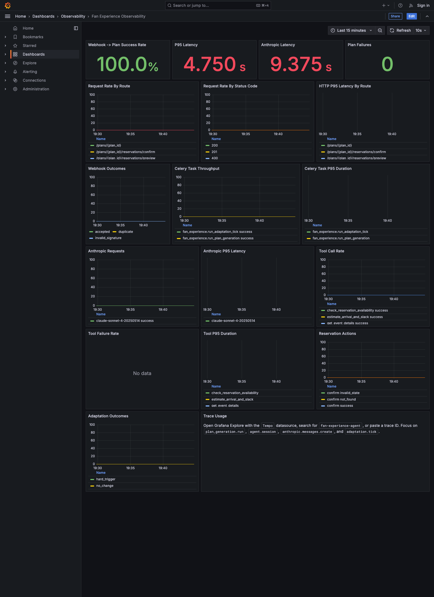
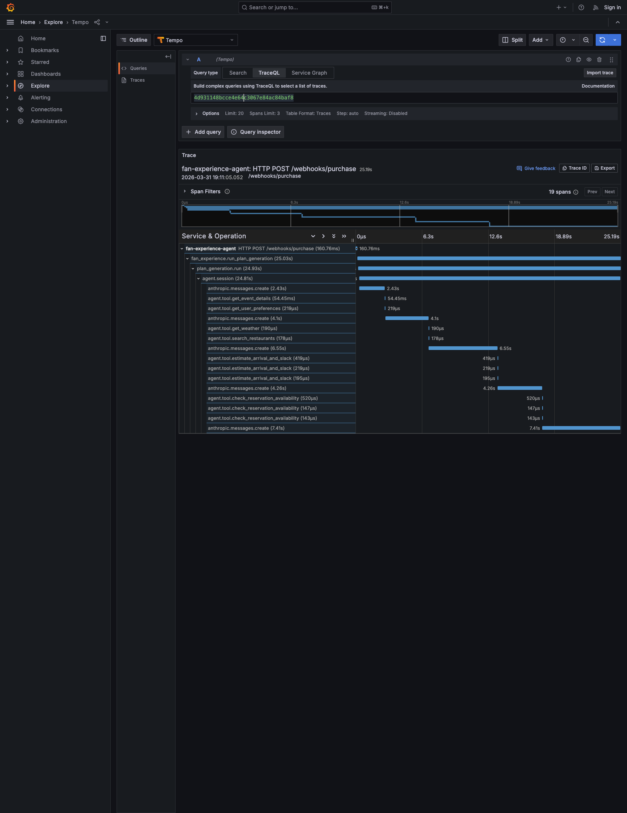

# Observability Screenshots

## Dashboard

Caption: Grafana overview dashboard after the live smoke flow, showing webhook-to-plan success, latency, Anthropic timing, and reservation/adaptation activity.

## Trace Waterfall

Caption: Tempo trace waterfall for one end-to-end purchase flow, including the webhook request, plan generation task, agent session, model calls, and tool execution spans.
